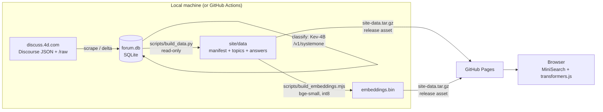

# 4D Forum Insights

A searchable, model-annotated index of every topic on the public 4D forum, [discuss.4d.com](https://discuss.4d.com).
It is a static GitHub Pages site and runs entirely in the browser, with no server and no generative model at query time.

**Site:** https://miyako.github.io/4d-forum-insights/

Main features:

- **Keyword search** over titles, English titles, one-line and one-paragraph summaries, and tags (MiniSearch).
  - Words are ANDed, falling back to OR when nothing matches.
  - `-word` excludes a word, and `"quoted phrases"` must match verbatim.
  - Diacritics are folded, and Japanese/Chinese text is matched with CJK bigrams.
- **Semantic search** with no LLM: the query is embedded in the browser by a small sentence-embedding model (transformers.js, bge-small, about 34 MB, cached by the browser) and compared with precomputed int8 topic embeddings.
- **Hybrid search** combines keyword and semantic rankings with reciprocal-rank fusion.
  - The semantic model is loaded lazily, so keyword search never waits for it.
- **Filters**, built from the question manifest:
  - every model question: feature-request level, post kind, "asks for a change", "missing capability"
  - category, or "not in category"
  - language, tags, date range, minimum votes, classified/enriched only
- **Sorting** by any model score or choice probability, latest activity, date, votes, likes, replies or views.
- **Preset views**, the main one being **Hidden feature requests**: topics the model rates as likely feature requests that were *not* posted in the Feature Request category (27).
- **Topic detail panel**:
  - the English summary
  - every model run's answers with their probability distributions
  - similar topics, by embedding
  - a link to the original thread
- **Shareable URLs**: the whole search state (query, mode, filters, sort, run, view, open topic) is kept in the query string.
- **Card and table views**, and a mobile layout.
- **Light, dark or Auto theme**. Auto follows the OS and is the default. The choice is kept in localStorage and applied before first paint, so the page never flashes the wrong theme.

Only titles, machine-translated titles, model-written summaries, metadata, model answers and links are published.
Forum post and thread text is never published.

## Architecture



| Path | What it is |
|------|------------|
| `site/` | The static site. Vanilla ES modules with no build step: `index.html`, `css/`, `js/`, and `vendor/minisearch.js`. |
| `site/data/` | Generated data. It is not committed; it is published as the release asset `site-data.tar.gz`. |
| `config/questions.json` | Display labels for the model questions (all optional). |
| `config/site.json` | Title, Feature Request category, preferred model run, preset views, embedding model. |
| `scripts/build_data.py` | Exports the published data from `forum.db`, opened read-only. |
| `scripts/build_embeddings.mjs` | Builds the quantised topic embeddings, incrementally. |
| `scripts/db-store.sh` | Pulls/pushes the delta workflow's encrypted working DB. |
| `pipeline/` | A vendored copy of the `fminer` pipeline plus the `delta` command (see `pipeline/README.md`). |
| `.github/workflows/pages.yml` | Deploys the site with `actions/deploy-pages`. |
| `.github/workflows/delta.yml` | Weekly incremental update. |
| `tests/` | `node --test` unit tests for state, filters, sorting, search and decoding. |

### Published data format

All files are in `site/data/` and are referenced from `manifest.json` with content-hash `?v=` cache-busters.

| File | Size (17k topics) | Content |
|------|------|---------|
| `manifest.json` | ~25 KB | Questions, model runs, presets, categories, tags, languages, stats, embedding info. |
| `topics.json` | 4.7 MB (1.7 MB gzipped) | Columnar `{fields, rows}`: id, slug, title, title_en, cat, tags, lang, created, active, posts, views, likes, votes, flags, summary line. |
| `text.json` | 2.2 MB (0.7 MB gzipped) | Summary paragraphs aligned with the rows. Loaded after first paint and then added to the index. |
| `answers/<run>.json` | 20–500 KB | One file per model + prompt_version run: `{ids, keys, answers: {question: column}}`. Scores and probabilities are integers (score×100, permille). |
| `embeddings.bin` | ~6.5 MB | N × 384 int8 vectors (scaled per vector), plus `embeddings-ids.json`. Loaded only when semantic or hybrid search is used. |

Why MiniSearch over JSON instead of SQLite in the browser? With about 17k small records, the slim JSON compresses to about 2.4 MB in total. An in-memory index then gives instant faceting, and every facet count updates as you type. sql.js would add about 1 MB of wasm, and sql.js-httpvfs is only worth it for much larger datasets.

## Rebuilding the data

Requirements: [uv](https://docs.astral.sh/uv/), Node 20+, `sqlite3`.

```sh
make all        # snapshot → data → embeddings   (= make snapshot && make data && make embeddings)
make serve      # http://127.0.0.1:8000
make publish    # upload site-data.tar.gz to the "data" release and redeploy Pages
```

- `make snapshot` copies `~/4d-feature-miner/data/forum.db` to `build/forum.db`.
  - It uses sqlite's online `.backup` and opens the source read-only, so it is safe while the pipeline is running.
  - Override the source path with `FMINER_DB_SRC=...`.
- `make data` runs `scripts/build_data.py`.
  - It works on partial data: unenriched topics fall back to their original title, and unclassified topics are shown as "not classified".
- `make embeddings` embeds every topic that is new or whose text changed.
  - Vectors are cached by text hash in the published files, so reruns are incremental.
  - The full 17k run takes about 20 minutes on a laptop CPU with 2 threads; set `EMBED_THREADS` to change that.
  - `make embeddings-sample` embeds a deterministic 400-topic sample for development.
- `make test` runs the unit tests.

Enriched topics are embedded with their English title, summary line, summary paragraph and tags. Topics that are not yet enriched use their title and opening text; that text is only used locally and is never published.

## Adding a new question

Questions are data-driven end to end. To add a question:

1. Add it to `QUESTIONS` in the pipeline's `classify.py`, with type `score`, `choice` or `noul` (yes/no), its instructions, and its criteria or choices. Do this in upstream `4d-feature-miner` and then re-vendor (`pipeline/`), because the prompt version is a hash of `QUESTIONS`.
2. Run the classifier. Its answers are stored as JSON in `classifications.answers` under a new `prompt_version`, so the new questions become a new **run**.
3. `make data` publishes the run:
   - The manifest picks up the question's type, levels and choices from the answers, and its description from the vendored `QUESTIONS`.
   - The UI then shows a filter, a table column, a sort option, card chips and the detail-panel distribution for it, with no code changes.
4. Optionally, give it a nicer label, short name, order or level/choice labels in `config/questions.json`. Add a preset to `config/site.json` if it deserves one, for example `{"id": "workaround", "label": "Has a workaround", "params": "a.workaround=yes"}`.

**Multiple runs.** Every (model, prompt_version) pair is a separate run.

- The "Model run" selector chooses which run drives the filters, sort and chips. The detail panel always shows every run's answers.
- `config/site.json` → `preferred_runs` picks the default run, and `hidden_runs` hides runs.
- Run files carry their own level and choice order, so questions can evolve between versions.

URL parameters for answers are `a.<question>=<levels or choices>`, for example `a.fr=3,4` or `a.kind=bug_report`. Yes/no questions use `a.<question>=yes|strong|no`.

## Delta updates

`.github/workflows/delta.yml` runs every Monday and on demand (`workflow_dispatch`, with inputs for budgets, skipping the models, and a full re-list). The steps are:

1. **Pull** the working DB, an encrypted release asset (see below).
2. **Fetch the delta** with `fminer delta`, using the same polite `4d` User-Agent as the scraper. It checks `robots.txt` before fetching (`User-agent: 4d` is allow-listed) and throttles to about 1 request per second.
   - **New topics and topics with new replies**: walks `/latest.json` pages until a page has no topic whose `bumped_at` changed, then re-fetches `/raw/{id}`.
   - **Edits**: editing a post does not bump a topic, so `/latest.json` cannot see edits. Instead the delta re-fetches `/raw/{id}` for a sweep and compares the text.
     - The sweep covers every topic active in the last 45 days, plus a rolling window of the 300 topics with the oldest fetch time, so all 17k topics are re-checked about once a year.
     - Comparing the raw text costs the same one request as reading `/t/{id}.json` post `version`s, and it is exact.
     - Only a real change moves the new `raw_changed_at` column, which marks the topic for re-enrichment.
   - In the first week of each month it also re-lists every topic (`--full-list`) to refresh votes, views and likes.
3. **Enrich** new and changed topics with gemma-4-E4B, **backfill** missing or short summaries with the same model (`fminer enrich --resummarise-empty`, which also drops those topics' classifications), then **classify** with Kev-4B (`--stale` redoes topics whose input or summary changed).
   - All model steps are time-boxed (`--budget-minutes`, 180 + 90 by default; enrich and the backfill share the 180) and resumable, so a backlog spreads over several runs.
4. **Save** the DB. This runs even if a later step fails, so progress is never lost.
5. **Export** with `make data`, **embed** only the new or changed topics (the previous `site-data.tar.gz` is the cache), upload `site-data.tar.gz`, and **deploy** Pages.

### Running the models on GitHub-hosted runners

There is no GPU, so the models run on the CPU of a standard `ubuntu-latest` runner, which for public repositories has 4 vCPU, 16 GB RAM and about 14 GB free disk (after the workflow deletes unused toolchains). It uses a prebuilt llama.cpp release (`llama-bNNNN-bin-ubuntu-x64.tar.gz`), which includes `--spec-type draft-mtp` and the `/v1/systemone` endpoint, so no compile step is needed.

- The models run **one after the other**, and each is deleted after use: gemma Q8 is 7.6 GB and Kev-4B Q8 is 4.2 GB, and both together would not fit on the disk.
- **macOS runners** (arm64, Metal) were ruled out: they have 7 GB RAM, too little for gemma-4-E4B Q8.
- **Throughput estimate** on 4 vCPU:
  - enrich: about 1.5–3 minutes per topic (translation and two summaries of the thread)
  - classify: about 10–30 seconds per topic
  - the forum's normal delta is about 30 topics a week (126 bumped in the last 28 days), so this fits comfortably in a 6-hour job
  - the budgets stop starting new work after 180 + 90 minutes, and the job times out at 345 minutes
- A long backlog, such as the first catch-up or a full re-run after a prompt change, is better done locally.

### Where the working DB lives

The pipeline DB is about 160 MB. It contains full thread text, and this repository is public.

- The DB is therefore never committed. Instead it is stored, **zstd-compressed and AES-256 encrypted** (about 47 MB), as the asset `forum.db.zst.enc` on the `data` release, with the previous copy kept as `forum.db.prev.zst.enc`.
- The passphrase is the repository secret `DB_KEY`.
- Release assets survive indefinitely and have no size problem. The Actions cache would be evicted after 7 days of inactivity.

One-time setup, after `~/4d-feature-miner` has finished:

```sh
export DB_KEY="$(openssl rand -base64 32)"        # keep it, e.g. in your password manager
gh secret set DB_KEY --body "$DB_KEY"
make db-seed                                       # snapshot ~/4d-feature-miner's DB → encrypted release asset
```

Until the DB is seeded, the delta workflow logs a warning and does nothing.

### Local fallback (e.g. a Mac with Metal)

If CPU runs are too slow, or there is a backlog, run the same delta locally and push the results:

```sh
export DB_KEY=...                                  # same passphrase as the secret
make db-pull                                       # → build/work.db
LLAMA_SERVER=~/llama.cpp/build/bin/llama-server make delta-local   # fetch + enrich + summary backfill + classify
make db-push                                       # save the DB for the next Actions run
make snapshot data embeddings FMINER_DB_SRC=build/work.db && make publish
```

The local llama-servers listen on ports 18081 and 18080, so they never collide with an upstream pipeline on 8081 and 8080. You can also run the workflow with `skip_models: true` to fetch on Actions only, and run the models locally later.

## Notes on the data

- In the first enrich pass about 57% of the topics got an **empty `summary_paragraph`** (only the one-line summary was filled). Upstream fixed this in `8381102` (schema minimum lengths, retries and a `--resummarise-empty` backfill), and the vendored pipeline has the same fix. The site still falls back to the summary line for any topic left without a paragraph.
- Score levels are bucketed to the nearest level, which is equivalent to the classifier's 0.5, 1.5, 2.5 and 3.5 thresholds. The "Most likely" bucket is therefore rare: it needs an expected score of at least 3.5.
- Languages come from the enrich step. For topics that are not yet enriched they are guessed from the text and shown as "(guessed)" in the detail panel.
