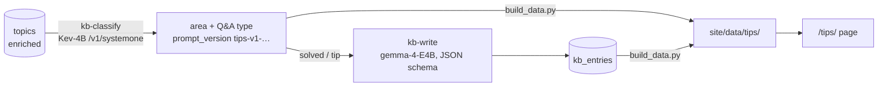

# Tips: a knowledge base mined from the forum

`/tips/` (https://miyako.github.io/4d-forum-insights/tips/) turns forum threads into short knowledge-base entries.
An answered question becomes a **question + answer**, and shared know-how becomes a **headline + summary**.
You can browse the entries by area and search them by keyword, by meaning (semantic), or both (hybrid).
Every entry links to the original thread.

It is the same static site and the same data release as the main page. Nothing runs on a server, and no
generative model runs at query time.

## How the entries are made



1. **`fminer kb-classify`** asks the decision model (Kev-4B) two questions about every enriched topic. It sees the English title, the English first post, the reply count and whether there is an accepted answer.
   - `area`, one choice of: Language, Interface, Database, Web & network, Administration, 4D Write Pro, 4D View Pro, Third party (plugins, components, external tools), Other.
   - `qa`, one choice of:
     - `solved`: a question that the thread answers
     - `open`: a question with no answer
     - `tip`: know-how or a how-to that someone shares
     - `other`: announcements, discussions
   - The answers are stored in `classifications` like any other run, under `prompt_version = tips-v1-<hash>`. They are published under `manifest.tips`, not `manifest.runs`, so the main page ignores them.
2. **`fminer kb-write`** sends every topic whose latest tips answer is `solved` or `tip` to the generative model (gemma-4-E4B). The model gets the English title, the English first post, the summary and a 6,000-character excerpt of the thread with code shortened. It writes an entry under a JSON schema:
   - `solved` → `question`: one generic, searchable question that starts with How / Why / What / Which / Where / Can / Is / Does. `answer`: at most 70 words.
   - `tip` → `headline` (at most 12 words, not a question) + `summary` (at most 70 words).
   - `answered`: the model's own check that the thread really contains an answer or tip. Entries with `answered = false` are hidden by default; the page shows them with "show unverified" (`all=1`).
   - Each entry also gets automatic checks: length, a question mark, a question word, and truncation. A failed entry is retried up to 3 more times at a higher temperature, and the candidate with the fewest problems is kept.
   - Entries go into the `kb_entries` table (topic_id, mode, headline, body, answered, problems, model, prompt_version, created_at, error).
3. **`scripts/build_data.py`** publishes:
   - `tips/answers/<run>.json`: area + type with probabilities, in the same columnar format as the other runs;
   - `tips/entries.json`: `{ids, modes, mode, headline, body, ok}`, where ok is 1 = good, 0 = not answered, 2 = did not pass every check.

   Labels, presets and the area threshold come from `config/tips.json`.

As on the main page, no post or thread text is published. Only model-written entries, titles, summaries, metadata, model answers and links are.

## The page

- **Areas**: multi-select chips with live counts.
  - A topic belongs to its chosen area and to every other area whose probability is at least `area_min_p` (0.25).
  - So a View Pro question about a formula can show up under both 4D View Pro and Language.
- **Type**: Answered question / Tip / Open question / Other. The default is Answered + Tip.
  - **Confidence** filters on the model's probability for the type.
  - **Since** filters by year.
- **Search**: Keyword (MiniSearch over the entry, the original title and the tags), Semantic (the topic embeddings of the main page, embedded in the browser by transformers.js), or Hybrid (reciprocal-rank fusion).
- **Cards** show:
  - the question or headline, and the answer;
  - area chips (click one to filter);
  - the original title, date, language, replies, views and likes, and whether the thread has an accepted answer;
  - "Open thread ↗".
  - "Why is this here?" gives the type and area probabilities, the entry status and the thread summary.
- Topics without an entry, such as open questions, fall back to the English title and the one-line summary.
- **URL state**: `q`, `mode`, `area`, `type`, `conf`, `since`, `sort`, `all`, for example `tips/?area=database&q=orda`.
- The main page links to `/tips/` only when the manifest has tips data.

## Running it

Both commands need a llama-server. The two models do not fit in 16 GB together, so `pipeline/ci/run-kb.sh` runs **one server at a time**:
1. It starts Kev-4B on :18080, runs `kb-classify`, then stops it.
2. It starts gemma on :18081, runs `kb-write`, then stops it.

It uses ports 18080/18081, so it never collides with the upstream pipeline on 8080/8081. It is resumable, so you can rerun it at any time to continue.

```sh
# pilot: classify a random sample of 300 topics in a copy of the snapshot (build/tips.db), write their entries
make kb-pilot                                   # KB_SAMPLE=300 by default
make data DB=build/tips.db && make serve        # preview http://127.0.0.1:8000/tips/

# full run on the delta workflow's working DB, then publish
make db-pull                                    # build/work.db (needs DB_KEY, see docs/delta-setup.md)
make kb                                         # KB_DB=build/work.db by default
make db-push                                    # keep the entries for the next delta run
make data DB=build/work.db && make embeddings && make publish
```

- `make kb` is incremental:
  - `kb-classify --stale` redoes topics that were re-enriched after the delta workflow saw new replies.
  - `kb-write` redoes topics whose classification is newer than their entry.
- So rerunning it after each delta run keeps the knowledge base current.
- **Don't run it while the delta workflow is running.** Both push the same encrypted DB, and the last push wins.

Useful environment variables for `run-kb.sh` / `make kb`:

| Variable | Meaning |
|---|---|
| `SAMPLE` | classify a random sample only |
| `CLASSIFY_BUDGET`, `WRITE_BUDGET` | stop after N minutes; the next run resumes |
| `MIN_P` | minimum probability of solved/tip for writing an entry (default 0, see below) |
| `SKIP_CLASSIFY=1`, `SKIP_WRITE=1` | run one half only |
| `WORKERS` | parallel requests (default 4) |
| `LLAMA_SERVER` | the llama-server binary |
| `GEN_MODEL`, `DECISION_MODEL`, `GEN_ARGS`, `DECISION_ARGS` | as in `run-delta.sh` |

`make kb-stats` (or `fminer kb-stats`) shows progress.

### Time (M1 Pro, 16 GB, 4 workers)

| Step | Rate | Full run |
|---|---|---|
| kb-classify (Kev-4B) | ~38 topics/min | 17,003 topics ≈ 7.5 h |
| kb-write (gemma-4-E4B, MTP) | ~17 entries/min | ~64% of topics are solved/tip, so ≈ 10,900 entries ≈ 10.5 h |

You can split it over several nights with `CLASSIFY_BUDGET` / `WRITE_BUDGET`.

## Pilot results (300 random topics)

- **Type:** solved 164, open 74, other 34, tip 28. **Area:** language 84, interface 55, administration 43, web 28, database 26, other 24, third party 22, Write Pro 9, View Pro 9.
- **Probabilities:** moderate, 0.3–0.7. Nine areas and four types split the probability mass.
- **Entries:** 192 written with 0 errors.
  - Solved: 158 of 164 pass the writer's `answered` check, and 0 have quality problems.
  - Tip: 15 of 28 pass. The decision model's `tip` class is broad: it includes announcements and questions that share code. The writer's check filters these out.
- **`MIN_P` defaults to 0.** For `solved`, the share of entries that pass the `answered` check is above 92% at every level of the classifier's probability:
  - p < 0.4: 37 of 40;
  - p ≥ 0.6: 59 of 59.

  A threshold would only drop good entries, so the writer's check is the filter.

## The gemma "empty reply" bug (and fix)

With `response_format: json_schema`, gemma-4 starts in its *thinking* channel even with
`chat_template_kwargs: {enable_thinking: false}`. Every token then goes to `reasoning_content`, `content` stays `''`,
and the request stops with `finish_reason: length`.

`KbLLM` in `pipeline/src/fminer/kb.py` avoids this:
- it does **not** send `chat_template_kwargs`;
- it bans the channel token with `logit_bias: [[<id of "<|channel>">, false]]`. The id is looked up once through `/tokenize` with `parse_special`.

With that, the pilot had 0 empty replies.

This is very likely why topics 11750 and 13580 failed to enrich upstream (see "Notes on the data" in the README). The vendored `enrich.py` still uses the upstream request, so those two topics may fail again in the delta workflow until the same fix is applied there.

## Adding or changing questions

`QUESTIONS` in `kb.py` is the source of truth, and the prompt version is a hash of it. If you change an area or a type, the next `kb-classify` run produces a new run (`tips-v1-<new hash>`).
- `config/tips.json` → `preferred_runs` (model names) picks the run the page uses: the most recent run of the first listed model that has one.
- The page reads the areas and types from the manifest, so new choices appear without code changes. Labels and descriptions go in `config/tips.json` → `questions`.
